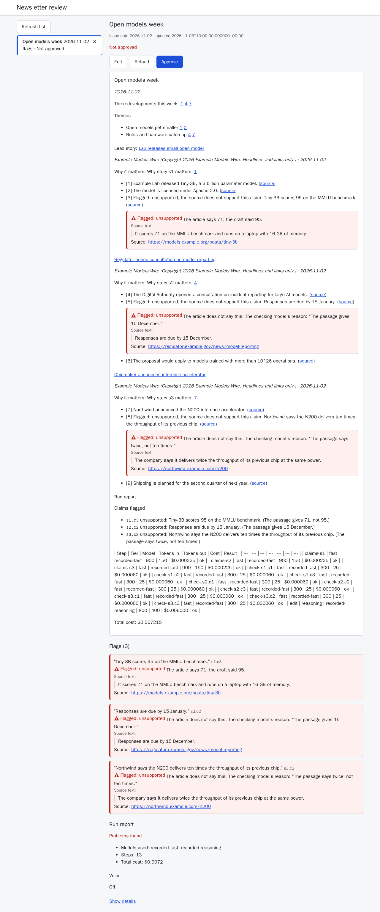
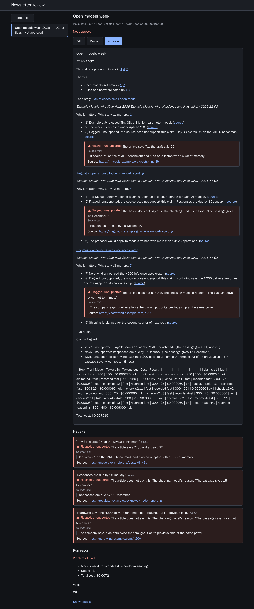
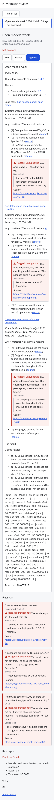
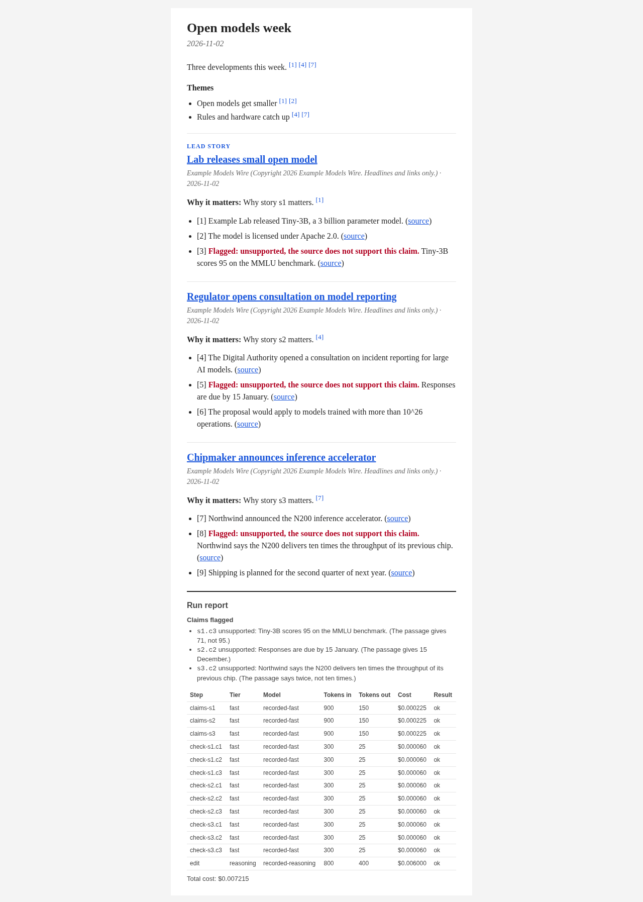

# llm-newsletter-generator

[](https://github.com/samestrin/llm-newsletter-generator/stargazers) [](https://github.com/samestrin/llm-newsletter-generator/network/members) [](https://github.com/samestrin/llm-newsletter-generator/watchers)

[](https://opensource.org/licenses/MIT) [](https://www.python.org/)

**llm-newsletter-generator** is a Python package that generates text-only newsletters from RSS feeds using LLMs. See [VISION.md](VISION.md) for the plan.

## What it does

It reads RSS and Atom feeds and drafts an issue that a person reviews before it goes anywhere:

1. The fast model writes claims for each story, each one quoting the passage it came from.
2. Each claim is checked against its passage. A claim the source does not support stays in the issue, marked as flagged; it is never quietly dropped or quietly passed.
3. The reasoning model edits the issue (lead story, themes, intro, why each story matters) and may cite only supported claims. When a yourvoice.dev key is set, that prose is rewritten in the writer's own voice, with every link, quote and number kept as it was.
4. The issue is rendered as Markdown and as an HTML email, with a run report: failed feeds, flagged and dropped claims, and each model call with its tokens and cost.
5. A person reads the draft on the review page, edits it and approves it. Any edit clears the approval.

The review page, showing a draft with its three flagged claims and its run report, in light and dark mode:




At phone width (360 px) the page is one column:



The same issue as the HTML email. The three claims the source does not support are flagged in red:



All of these show the `open-models-week` eval case below, replayed from recorded model answers. The browser test (`cd web && npm run test:e2e`) saves them to `docs/img/` against a fake API. A real issue, with its email and archive page, is in [`docs/sample/`](docs/sample/).

Grouping stories from several feeds is later work.

## Installation

Requires Python 3.11+ and [uv](https://docs.astral.sh/uv/).

```bash
git clone https://github.com/samestrin/llm-newsletter-generator/
cd llm-newsletter-generator
uv sync
```

Dependencies are declared in `pyproject.toml`, which is also where the version lives.

## Usage

```bash
uv run newsletter --help
uv run newsletter --version
NEWSLETTER_FAST_MODEL=gpt-4o-mini NEWSLETTER_REASONING_MODEL=o4-mini NEWSLETTER_API_KEY=... \
  uv run newsletter issue https://example.com/feed.xml --title "AI Weekly" -o issue.md
```

`newsletter issue` reads RSS or Atom feeds (and, from a config file, web pages and Hacker News), groups copies of one story into one story with all its sources and ranks the stories by the topic with the embedding model, has the fast model extract claims that quote their source, checks each claim against its passage, and has the reasoning model edit the issue (lead, themes, intro and why it matters) from the supported claims only. It writes the issue as Markdown (`-o`, else stdout) and, with `--html FILE`, as an HTML email. Every claim links to its source; unsupported or unchecked claims stay visible and are marked as flagged. A run report lists failed sources, the linked articles read for link-only items and those skipped, items that could not be grouped or were dropped, a failed embedding call, dropped and flagged claims, a failed editor call, the writer's voice and the cost of each step. It exits 1 when anything failed or is flagged, so a partial issue is never reported as a success. Use `--cache-dir` to keep fetched feeds between runs, `--date` to set the issue date and `--per-feed N` to use only the first N items of each feed (each item costs several model calls).

Instead of listing feeds, `--config FILE` (on `issue` and `serve`; `archive` takes feed URLs only) reads a YAML file:

```yaml
topic: open-weight language models   # what the stories are ranked by
sources:
  - https://example.com/feed.xml     # a bare URL is an RSS or Atom feed
  - feed: https://lab.example.org/atom.xml
  - page: https://example.com/2026/11/article   # one web page, its main text
  - hackernews: {min_score: 100, limit: 30}     # front-page stories at or over the score
limits:
  per_feed: 5                        # first N items of each feed, and of Hacker News
```

It is checked on load, and an error names the file and the field (exit 2). Feed URLs on the command line replace every source in the file, and `--per-feed` wins over `limits.per_feed`. Pages and Hacker News are fetched with the same timeout, 10 MB cap, robots.txt check and private-address redirect check as feeds. An item that carries no story text of its own (a Hacker News story, an hnrss entry, or a feed item with under 50 characters once its title, URLs and points and comments lines are taken out) gets the linked article's main text instead, read the same way; the run report lists each article read, and each one that could not be read, with why. Such an item is skipped, never summarized from its title or metadata. Claims that state only a URL or a points, votes or comments count are dropped and listed in the run report. One `embedding` call compares the topic and every item: items close enough to each other become one story with all their sources ("Also covered by"), and the stories closest to the topic come first. An item that cannot be compared is its own story, last, and listed in the run report; if the call fails, every item is its own story and the report says why.

```bash
uv run newsletter archive --demo --site site --per-feed 5 https://example.com/feed.xml
```

`newsletter archive` drafts a plain issue, one fast-model summary and one link per item, with `--topic` given to the model (in the writer's voice too, when `YOURVOICE_API_KEY` is set) and builds it into a static site in `--site`: an index and one page per issue. Only demo mode exists so far, so `--demo` is required. A demo issue is approved by a record marked `automated-demo` instead of a person's sha256 of the text; that record is valid for archive pages only and export refuses it. Every demo page carries a visible "Automated demo" label, and every summary is marked as unchecked. With `--markdown PATH` and `--html PATH`, the same draft is also written as Markdown and as an HTML email, with the same label and marks; like the site, their run report names feed hosts and counts only, never a feed URL, an error, a path or a model.

### Archive in CI

No workflow builds the archive on a schedule. Run `newsletter archive --demo --site DIR FEED_URL...` yourself with a model configured; `tests/test_daily.py` runs the same build offline with fake feeds and a fake model.

## Configuration

The CLI talks to any OpenAI-compatible endpoint; all model settings come from the environment:

| Variable | Purpose |
| --- | --- |
| `NEWSLETTER_BASE_URL` | Endpoint, default `https://api.openai.com/v1` |
| `NEWSLETTER_API_KEY` | API key (or `OPENAI_API_KEY`); optional for local endpoints |
| `NEWSLETTER_FAST_MODEL` | Model for bulk work; required by both commands |
| `NEWSLETTER_REASONING_MODEL` | Model for the editor pass and the writer's voice; required by `newsletter issue` |
| `NEWSLETTER_EMBEDDING_MODEL` | Model that groups copies of one story and ranks stories by the topic; required by `newsletter issue` and by a `serve` run |
| `NEWSLETTER_<TIER>_PRICE_INPUT` / `NEWSLETTER_<TIER>_PRICE_OUTPUT` | USD per million tokens; without them the cost the server reports is used, else the cost is unknown |
| `NEWSLETTER_TIMEOUT` | Seconds per `fast` or `embedding` request, default 60 |
| `NEWSLETTER_REASONING_TIMEOUT` | Seconds per `reasoning` request (the editor pass and the writer's voice), default 300: a reasoning model can take minutes to edit. An editor that runs out of time leaves the issue with no intro, themes or lead, says so in one plain sentence (`editor_message`, on the run and in the report) and keeps the raw error in the report's `editor_error` |
| `NEWSLETTER_MAX_RETRIES` | Retries after a timeout, connection error, 408, 409, 429 or 5xx, default 2 |

A tier's model is required only when that tier is used. The API key is never logged or reported.

### The writer's voice

When `YOURVOICE_API_KEY` is set, the editor's prose is rewritten in the writer's own voice: in `newsletter issue` and `newsletter serve` the intro, the theme names and each "why it matters" line, and in `newsletter archive` each summary. Claims, their quotes, numbers and source links, and the citations on the prose are never sent to the rewrite, so they stay exactly as they were. [yourvoice.dev](https://yourvoice.dev) builds a voice profile from samples of the writer's writing, and the reasoning model rewrites the prose to match it. Then a check compares every link, quoted string, number and claim id before and after the rewrite. If one is dropped, changed or added, or the profile or the rewrite fails or times out, the neutral text is kept and the run report says which one and why. The command then exits 1. Without the key, the issue stays in a neutral voice, and the run report says so.

| Variable | Purpose |
| --- | --- |
| `YOURVOICE_API_KEY` | yourvoice.dev API key; turns the voice on. Sent as `X-API-Key`, never logged or reported |
| `NEWSLETTER_VOICE_SAMPLES` | Folder of the writer's own `.md` and `.txt` files to build the profile from |
| `NEWSLETTER_VOICE_CACHE_DIR` | Where the profile is cached, default `$XDG_CACHE_HOME/newsletter/voice` (`~/.cache/newsletter/voice`). A run builds a new profile only when the samples change; each build costs yourvoice.dev credits |
| `YOURVOICE_BASE_URL` | Default `https://api.yourvoice.dev` |
| `YOURVOICE_TIMEOUT` | Seconds per request, default 60 |

### The API

`newsletter serve` runs an HTTP API for drafting and reviewing issues. A run reads the feeds (or, started with `--config FILE`, the sources in that file when the run names no feeds), groups and ranks the stories, then the editor checks each claim against its source and writes the issue, then the voice pass rewrites the editor's prose, then the issue is rendered. Each run is a background job with a status and a timeout. Its result is a draft: the rendered Markdown, the flagged claims (each with its passage, its source link and an `explanation` built in code, such as "The article says 71; the draft said 95.") and the run report, kept as a JSON file in the data dir, so it survives a restart. Approving a draft stores the sha256 of its text. Any edit clears the approval.

```bash
export NEWSLETTER_API_TOKEN=$(openssl rand -hex 32)
uv run newsletter serve            # http://127.0.0.1:8000
curl -X POST http://127.0.0.1:8000/api/runs \
  -H "Authorization: Bearer $NEWSLETTER_API_TOKEN" -H "Origin: http://127.0.0.1:8000" \
  -H "Content-Type: application/json" -d '{"feeds": ["https://example.com/feed.xml"]}'
```

The routes are not listed here: the API writes its own reference. `GET /api/openapi.json` is the OpenAPI spec — every route, the fields it takes, the replies and error responses it sends, the run states, the 409 while another run is going and the 409 from an approval whose sha256 no longer matches — and [http://127.0.0.1:8000/api/docs](http://127.0.0.1:8000/api/docs) is a Scalar page that reads it. Both are served by the API itself (the Scalar script is vendored, so neither page loads anything from a CDN) and both are readable without the token, since the spec holds route names and schemas only. The reference's Test Request sends the token you give it, declared in the spec as its bearer scheme.

Every call but the health check needs `Authorization: Bearer $NEWSLETTER_API_TOKEN`. A write also needs an `Origin` from `NEWSLETTER_API_ORIGINS` and a JSON object sent as `application/json`; anything else is refused with 401, 403, 415 or 400. Without a token, the server will not start. The token and the model and voice keys never appear in a response, an error body, a stored file or a log.

| Variable | Purpose |
| --- | --- |
| `NEWSLETTER_API_TOKEN` | The token every call must send; required |
| `NEWSLETTER_API_HOST` | Bind address, default `127.0.0.1` (this machine only). `--host` overrides it |
| `NEWSLETTER_API_PORT` | Port, default 8000. `--port` overrides it |
| `NEWSLETTER_API_ORIGINS` | Comma-separated origins allowed to write, default `http://127.0.0.1:<port>,http://localhost:<port>` |
| `NEWSLETTER_DATA_DIR` | Where drafts and runs are kept, default `$XDG_DATA_HOME/newsletter` (`~/.local/share/newsletter`) |
| `NEWSLETTER_RUN_TIMEOUT` | Seconds a whole run may take, every model call and retry included, default 900 |

`uv run newsletter serve --seed-sample` writes the committed `open-models-week` sample, with its flagged claims and run report, as one draft at start: once, so a restart adds no second copy and an existing draft is never overwritten or re-approved. It needs no model key and no network, which is what the review deploy (`docker-compose.embassy.yml`, described in [`docs/deploy/embassy.md`](docs/deploy/embassy.md)) starts with.

### The review page

`web/` is a page (React and Vite) for reviewing drafts. Paste the API token, pick a draft, and read it as a newsletter, drawn from its Markdown (headings, lead, themes, stories and claim links), with its flagged claims and its run report: failed feeds, linked articles read or skipped, dropped stories and claims, editor and voice problems, and each model call with its tokens and cost. Each flagged claim has a note beside it, marked by text and icon: why it is flagged in plain words (the model's reason on a draft from before explanations were kept), the source passage and the source link. The run's focus, when it had one, is shown above the draft and in the run report. Edit opens the Markdown in a text box: Save stores it, which clears any approval (the page warns you first on an approved draft), and Done editing goes back to the newsletter; Done editing, Reload and Approve are off while an edit is unsaved, and Discard changes drops it. It sends the sha256 of the text you read, so if the draft changed since, the API refuses it and the page says so; Reload fetches the new text. Once Approve succeeds, the page opens "Email preview": the HTML from `GET /api/drafts/{id}/email` in an `iframe` with `sandbox=""` and `srcdoc`, so it runs no script and loads nothing, under "Nothing was sent. This is what would go out." There is no send button; saving an edit clears the approval and hides the preview. HTML in the draft is always shown as text, never run (`react-markdown` without `rehype-raw`), and only absolute http and https URLs become links, opened in a new tab with `rel="noopener noreferrer"`. The token stays in the page's memory, so a reload asks for it again. When the server lists providers at `GET /api/providers`, the page asks for a demo code or your own key in a key panel instead (Key button in the header), keeps it in session storage (local storage with "Remember on this device"; Clear wipes both), and sends it only as the `X-Model-Preset` header with `X-Model-Key` or `X-Demo-Code`. With a key or code saved, the page opens on a form: up to six feed addresses (Add a feed, Remove, or a preset from `GET /api/presets` to fill them), each checked with `POST /api/feeds/check` when you leave it and again before the run, with "OK, 20 items" or the reason next to it; an optional focus of up to 300 characters; Make my newsletter, which stays off until one feed is OK; and See an example, which opens the seeded draft. A busy server says "Someone else is making one right now. Try again in a minute." and opens Try again after the wait it gives. Earlier drafts lists the example and the drafts this browser made: the owner token the server issues with a run is kept in session storage and sent back as `X-Owner-Token`. After Make my newsletter the page shows each step of the run from `GET /api/runs/{id}`, asked every 2 s: its state by text and icon, its counts as a progress bar, each failed feed with its reason, and how long a running step has run; after 30 s with no change it says "Still working on <step>…". It opens the draft when the run is done, shows the run's plain message and Start over when it fails, and says "Lost contact, retrying…" when a poll fails (it stops after 10 in a row and says so). A refused key (401) stops the polling at once and says so, and saving the key again carries on. Only the run's id is kept in session storage, so a reload resumes the progress once the key is back. While the draft list, a draft or its run report loads, the page says so; when there are no drafts yet, or a draft has no text or no run report, it says that; and when a load fails it shows the API's reason with a way to try again (Refresh list, Try again).

```bash
export NEWSLETTER_API_TOKEN=$(openssl rand -hex 32)
NEWSLETTER_API_ORIGINS=http://localhost:5173 uv run newsletter serve
cd web && npm ci && npm run dev    # http://localhost:5173, /api goes to 127.0.0.1:8000
```

The page's origin must be in `NEWSLETTER_API_ORIGINS`, or the API refuses its writes. `NEWSLETTER_API_URL` points the dev server's `/api` somewhere else. `VITE_API_URL` at build time makes the built page call the API there directly instead of on its own origin.

### Draft export

`newsletter.export` sends an approved issue to email platforms as a draft, never as a send. `export_draft(text, title=..., approval=..., connectors=connectors_from_env())` checks the approval before any request: only a person's approval whose sha256 matches the text as it is now passes, so an unapproved draft, an edited one or an `automated-demo` one is refused. `export_stored_draft(draft, connectors=...)` does the same for a draft as the API stores it.

Each connector is optional and is set up only when its key is set. Each makes one create call that asks for a draft, with no send call and no schedule:

| Platform | Call | Settings |
| --- | --- | --- |
| Buttondown | `POST /v1/emails` with `status: draft` | `BUTTONDOWN_API_KEY` |
| Beehiiv | `POST /v2/publications/{id}/posts` with `status: draft` | `BEEHIIV_API_KEY`, `BEEHIIV_PUBLICATION_ID` |
| Resend | `POST /broadcasts` with `send: false`; `/broadcasts/{id}/send` is never called | `RESEND_API_KEY`, `RESEND_SEGMENT_ID`, `RESEND_FROM` |

`NEWSLETTER_EXPORT_TIMEOUT` sets the seconds per request, default 30. The result lists each connector as exported, with its draft id, or failed, with the reason. An HTTP error, a timeout, a reply with no draft id or a reply with a status other than draft counts as failed, never as exported, and the others still run. There is no retry, since a repeated call could leave a second draft. A connector whose platform has no draft-only endpoint is dropped and listed. Keys are never logged or reported.

### Try it

No model key needed. On a fresh clone:

```bash
docker compose up --build --wait    # http://localhost:8080
```

Open http://localhost:8080 and paste the demo token `demo-token-change-me`. The page starts with no drafts, since no model has run. The sample issue lives in [`docs/sample/`](docs/sample/); its README records the model, the feeds and the command, and the issue, email and archive page land there with that one-off run. `docker compose down --volumes` stops it and clears the drafts.

The demo token is the compose default and is safe only because the page is published on `127.0.0.1` alone. Set your own before exposing it.

### Docker

```bash
docker compose up --build    # http://localhost:8080, token demo-token-change-me
NEWSLETTER_API_TOKEN=$(openssl rand -hex 32) docker compose up --build    # your own token
```

Two services: `api` (`newsletter serve`, drafts kept in the `drafts` volume) and `web` (the built review page behind nginx, which forwards `/api` to `api`). Only the page is published, on `127.0.0.1:8080` (`WEB_PORT` changes it); the API is not reachable from outside the compose network, and it allows writes only from the page's origin. `NEWSLETTER_API_TOKEN` defaults to `demo-token-change-me`. `NEWSLETTER_BASE_URL`, `NEWSLETTER_API_KEY`, `NEWSLETTER_FAST_MODEL`, `NEWSLETTER_REASONING_MODEL`, `NEWSLETTER_EMBEDDING_MODEL` and `YOURVOICE_API_KEY` are passed through from your shell when set. CI's `compose` job builds both images, starts them and checks the page, the proxied API and the token, with no environment set.

## Eval

`uv run python -m newsletter.evals` runs two past feeds through the claims, check and edit steps and scores the result. Each feed comes with a reference issue and the model's answers as they were recorded, including planted false claims: true passages with a false claim written over them. A claim counts as caught only if it is on that planted list and the check flagged it, so the check does not grade itself. The command exits 1 if a planted claim gets through, and CI runs it.

From [`evals/results.md`](evals/results.md):

| Case | Faithfulness | Flag rate | Planted false claims flagged | Reference coverage | Cost per issue |
| --- | --- | --- | --- | --- | --- |
| open-models-week | 100.0% | 33.3% | 3/3 | 100.0% | $0.0072 |
| science-weekly | 100.0% | 33.3% | 2/2 | 100.0% | $0.0128 |
| Total | 100.0% | 33.3% | 5/5 | 100.0% | $0.0100 |

These numbers are a replay of recorded responses, not a live run: they show that the scoring and the flagging work on known answers, not how often a given model makes things up. Faithfulness is the share of claims the check passed that are not planted false; the flag rate is flagged claims over all claims checked; reference coverage is the share of the reference issue's links that the issue's supported claims cite. `uv run python -m newsletter.evals --live -o evals/results.md` runs the same feeds against the models in your environment (and spends credit). A live run has no planted claims, so its faithfulness is n/a. `tests/test_readme.py` fails if this table and `evals/results.md` differ, or if `evals/results.md` is not what the replay prints. The [case study](docs/case-study.md) walks through what these numbers mean for the pipeline's design.

## Development

```bash
uv run pytest
uv run ruff check .
uv run ruff format --check .
uv run python -m newsletter.evals   # eval table from recorded responses, no network
cd web && npm ci && npm run build && npm test   # the review page: build, unit tests with coverage
npx playwright install chromium && npm run test:e2e   # browser test against a fake API, saves docs/img/
```

`LIVE_URL=... npm run capture:live` (in `web/`, with `LIVE_TOKEN` for a token other than the local demo one) records a session on a running instance instead: the drafts list, the seeded issue with a flagged claim and its citation, Approve, and `/api/docs`, written to `docs/img/demo.gif`. Every frame is 1280x800 and a set of frames that is any other size, or longer than 30 s, is refused. The normal `test:e2e` run skips it.

The screenshots' issue comes from fixtures in `web/e2e/fixtures/`, made from the `open-models-week` eval case. After a change to the renderer or the case, `uv run python tests/readme_issue.py` rewrites them; `uv run pytest` fails until it is run.

## Contribute

Contributions to this project are welcome. Please fork the repository and submit a pull request with your changes or improvements.

## License

This project is licensed under the MIT License - see the LICENSE file for details.

## Share

[](https://twitter.com/intent/tweet?text=Check%20out%20this%20awesome%20project!&url=https://github.com/samestrin/llm-newsletter-generator) [](https://www.facebook.com/sharer/sharer.php?u=https://github.com/samestrin/llm-newsletter-generator) [](https://www.linkedin.com/sharing/share-offsite/?url=https://github.com/samestrin/llm-newsletter-generator)
