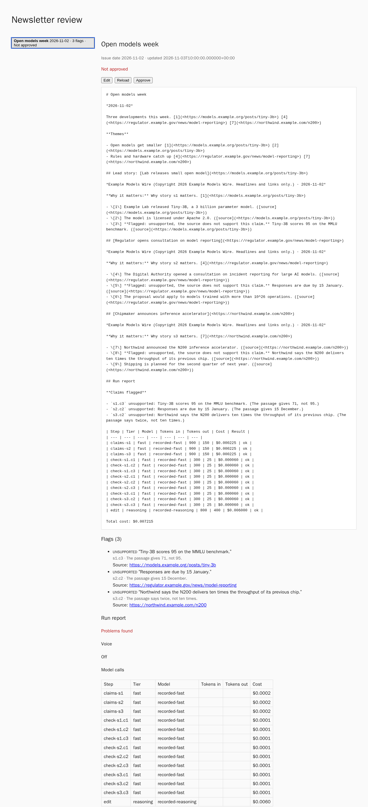
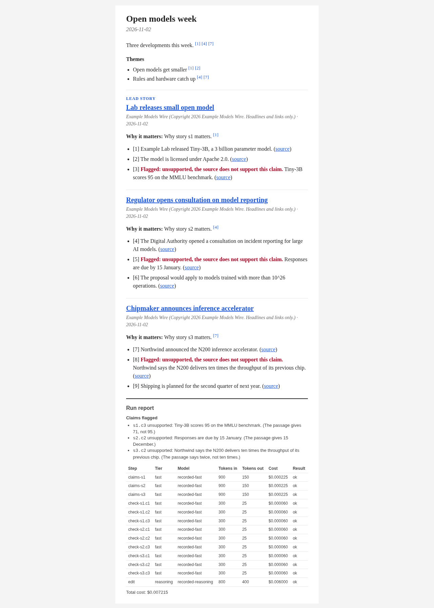

# llm-newsletter-generator

[](https://github.com/samestrin/llm-newsletter-generator/stargazers) [](https://github.com/samestrin/llm-newsletter-generator/network/members) [](https://github.com/samestrin/llm-newsletter-generator/watchers)

[](https://opensource.org/licenses/MIT) [](https://www.python.org/)

**llm-newsletter-generator** is a Python package that generates text-only newsletters from RSS feeds using LLMs. See [VISION.md](VISION.md) for the plan.

## What it does

It reads RSS and Atom feeds and drafts an issue that a person reviews before it goes anywhere:

1. The fast model writes claims for each story, each one quoting the passage it came from.
2. Each claim is checked against its passage. A claim the source does not support stays in the issue, marked as flagged; it is never quietly dropped or quietly passed.
3. The reasoning model edits the issue (lead story, themes, intro, why each story matters) and may cite only supported claims. When a yourvoice.dev key is set, that prose is rewritten in the writer's own voice, with every link, quote and number kept as it was.
4. The issue is rendered as Markdown and as an HTML email, with a run report: failed feeds, flagged and dropped claims, and each model call with its tokens and cost.
5. A person reads the draft on the review page, edits it and approves it. Any edit clears the approval.

The review page, showing a draft with its three flagged claims and its run report:



The same issue as the HTML email. The three claims the source does not support are flagged in red:



Both screenshots show the `open-models-week` eval case below, replayed from recorded model answers. The browser test (`cd web && npm run test:e2e`) saves them to `docs/img/` against a fake API.

Grouping stories from several feeds is later work.

## Installation

Requires Python 3.11+ and [uv](https://docs.astral.sh/uv/).

```bash
git clone https://github.com/samestrin/llm-newsletter-generator/
cd llm-newsletter-generator
uv sync
```

Dependencies are declared in `pyproject.toml`, which is also where the version lives.

## Usage

```bash
uv run newsletter --help
uv run newsletter --version
NEWSLETTER_FAST_MODEL=gpt-4o-mini NEWSLETTER_REASONING_MODEL=o4-mini NEWSLETTER_API_KEY=... \
  uv run newsletter issue https://example.com/feed.xml --title "AI Weekly" -o issue.md
```

`newsletter issue` reads RSS or Atom feeds (and, from a config file, web pages and Hacker News), groups copies of one story into one story with all its sources and ranks the stories by the topic with the embedding model, has the fast model extract claims that quote their source, checks each claim against its passage, and has the reasoning model edit the issue (lead, themes, intro and why it matters) from the supported claims only. It writes the issue as Markdown (`-o`, else stdout) and, with `--html FILE`, as an HTML email. Every claim links to its source; unsupported or unchecked claims stay visible and are marked as flagged. A run report lists failed sources, items that could not be grouped or were dropped, a failed embedding call, dropped and flagged claims, a failed editor call, the writer's voice and the cost of each step. It exits 1 when anything failed or is flagged, so a partial issue is never reported as a success. Use `--cache-dir` to keep fetched feeds between runs, `--date` to set the issue date and `--per-feed N` to use only the first N items of each feed (each item costs several model calls).

Instead of listing feeds, `--config FILE` (on `issue` and `serve`; `archive` takes feed URLs only) reads a YAML file:

```yaml
topic: open-weight language models   # what the stories are ranked by
sources:
  - https://example.com/feed.xml     # a bare URL is an RSS or Atom feed
  - feed: https://lab.example.org/atom.xml
  - page: https://example.com/2026/11/article   # one web page, its main text
  - hackernews: {min_score: 100, limit: 30}     # front-page stories at or over the score
limits:
  per_feed: 5                        # first N items of each feed, and of Hacker News
```

It is checked on load, and an error names the file and the field (exit 2). Feed URLs on the command line replace every source in the file, and `--per-feed` wins over `limits.per_feed`. Pages and Hacker News are fetched with the same timeout, 10 MB cap, robots.txt check and private-address redirect check as feeds. One `embedding` call compares the topic and every item: items close enough to each other become one story with all their sources ("Also covered by"), and the stories closest to the topic come first. An item that cannot be compared is its own story, last, and listed in the run report; if the call fails, every item is its own story and the report says why.

```bash
uv run newsletter archive --demo --site site --per-feed 5 https://example.com/feed.xml
```

`newsletter archive` drafts a plain issue, one fast-model summary and one link per item, with `--topic` given to the model (in the writer's voice too, when `YOURVOICE_API_KEY` is set; the daily workflow sets none) and builds it into a static site in `--site`: an index and one page per issue. Only demo mode exists so far, so `--demo` is required. A demo issue is approved by a record marked `automated-demo` instead of a person's sha256 of the text; that record is valid for archive pages only and export refuses it. Every demo page carries a visible "Automated demo" label, and every summary is marked as unchecked.

### Daily archive

`.github/workflows/daily.yml` runs `newsletter archive --demo` every day (and by hand from the Actions tab) on five public AI news feeds, five items each, and uploads the site as the `archive-site` workflow artifact. It has no deploy step and never runs on pull requests. To turn it on, set the secret `NEWSLETTER_API_KEY` and the repository variable `NEWSLETTER_FAST_MODEL` (and `NEWSLETTER_BASE_URL` for a non-OpenAI endpoint).

## Configuration

The CLI talks to any OpenAI-compatible endpoint; all model settings come from the environment:

| Variable | Purpose |
| --- | --- |
| `NEWSLETTER_BASE_URL` | Endpoint, default `https://api.openai.com/v1` |
| `NEWSLETTER_API_KEY` | API key (or `OPENAI_API_KEY`); optional for local endpoints |
| `NEWSLETTER_FAST_MODEL` | Model for bulk work; required by both commands |
| `NEWSLETTER_REASONING_MODEL` | Model for the editor pass and the writer's voice; required by `newsletter issue` |
| `NEWSLETTER_EMBEDDING_MODEL` | Model that groups copies of one story and ranks stories by the topic; required by `newsletter issue` and by a `serve` run |
| `NEWSLETTER_<TIER>_PRICE_INPUT` / `NEWSLETTER_<TIER>_PRICE_OUTPUT` | USD per million tokens; without them the cost the server reports is used, else the cost is unknown |
| `NEWSLETTER_TIMEOUT` | Seconds per request, default 60 |
| `NEWSLETTER_MAX_RETRIES` | Retries after a timeout, connection error, 408, 409, 429 or 5xx, default 2 |

A tier's model is required only when that tier is used. The API key is never logged or reported.

### The writer's voice

When `YOURVOICE_API_KEY` is set, the editor's prose is rewritten in the writer's own voice: in `newsletter issue` and `newsletter serve` the intro, the theme names and each "why it matters" line, and in `newsletter archive` each summary. Claims, their quotes, numbers and source links, and the citations on the prose are never sent to the rewrite, so they stay exactly as they were. [yourvoice.dev](https://yourvoice.dev) builds a voice profile from samples of the writer's writing, and the reasoning model rewrites the prose to match it. Then a check compares every link, quoted string, number and claim id before and after the rewrite. If one is dropped, changed or added, or the profile or the rewrite fails or times out, the neutral text is kept and the run report says which one and why. The command then exits 1. Without the key, the issue stays in a neutral voice, and the run report says so.

| Variable | Purpose |
| --- | --- |
| `YOURVOICE_API_KEY` | yourvoice.dev API key; turns the voice on. Sent as `X-API-Key`, never logged or reported |
| `NEWSLETTER_VOICE_SAMPLES` | Folder of the writer's own `.md` and `.txt` files to build the profile from |
| `NEWSLETTER_VOICE_CACHE_DIR` | Where the profile is cached, default `$XDG_CACHE_HOME/newsletter/voice` (`~/.cache/newsletter/voice`). A run builds a new profile only when the samples change; each build costs yourvoice.dev credits |
| `YOURVOICE_BASE_URL` | Default `https://api.yourvoice.dev` |
| `YOURVOICE_TIMEOUT` | Seconds per request, default 60 |

### The API

`newsletter serve` runs an HTTP API for drafting and reviewing issues. A run reads the feeds (or, started with `--config FILE`, the sources in that file when the run names no feeds), groups and ranks the stories, then the editor checks each claim against its source and writes the issue, then the voice pass rewrites the editor's prose, then the issue is rendered. Each run is a background job with a status and a timeout. Its result is a draft: the rendered Markdown, the flagged claims and the run report, kept as a JSON file in the data dir, so it survives a restart. Approving a draft stores the sha256 of its text. Any edit clears the approval.

```bash
export NEWSLETTER_API_TOKEN=$(openssl rand -hex 32)
uv run newsletter serve            # http://127.0.0.1:8000
curl -X POST http://127.0.0.1:8000/api/runs \
  -H "Authorization: Bearer $NEWSLETTER_API_TOKEN" -H "Origin: http://127.0.0.1:8000" \
  -H "Content-Type: application/json" -d '{"feeds": ["https://example.com/feed.xml"]}'
```

| Endpoint | Does |
| --- | --- |
| `GET /api/health` | `{"ok": true}`; the only call without the token |
| `POST /api/runs` | Starts a run from `{"feeds": [...], "title", "topic", "date"}`; 202 with the run, 409 while another run is going. With `serve --config`, `feeds` may be left out to read the file's sources, and `topic` defaults to the file's |
| `GET /api/runs/{id}` | The run: `queued`, `running`, `done` with its `draft_id`, or `error` with why. A run past its timeout, or cut off by a restart, ends as an `error` and leaves no draft |
| `GET /api/drafts` | Every draft, newest first, without its text |
| `GET /api/drafts/{id}` | The draft: `text`, `flags`, `report`, `approval` and `approved` |
| `PUT /api/drafts/{id}` | Replaces the text from `{"text": "..."}` and clears the approval |
| `POST /api/drafts/{id}/approve` | Approves the text as it is now. Send `{}`, or `{"sha256": "..."}` of the text you read to get a 409 if it changed since |

Every call but the health check needs `Authorization: Bearer $NEWSLETTER_API_TOKEN`. A write also needs an `Origin` from `NEWSLETTER_API_ORIGINS` and a JSON object sent as `application/json`; anything else is refused with 401, 403, 415 or 400. Without a token, the server will not start. The token and the model and voice keys never appear in a response, an error body, a stored file or a log.

| Variable | Purpose |
| --- | --- |
| `NEWSLETTER_API_TOKEN` | The token every call must send; required |
| `NEWSLETTER_API_HOST` | Bind address, default `127.0.0.1` (this machine only). `--host` overrides it |
| `NEWSLETTER_API_PORT` | Port, default 8000. `--port` overrides it |
| `NEWSLETTER_API_ORIGINS` | Comma-separated origins allowed to write, default `http://127.0.0.1:<port>,http://localhost:<port>` |
| `NEWSLETTER_DATA_DIR` | Where drafts and runs are kept, default `$XDG_DATA_HOME/newsletter` (`~/.local/share/newsletter`) |
| `NEWSLETTER_RUN_TIMEOUT` | Seconds a run may take, default 900 |

### The review page

`web/` is a page (React and Vite) for reviewing drafts. Paste the API token, pick a draft, and read its text with its flagged claims and its run report: failed feeds, dropped stories and claims, editor and voice problems, and each model call with its tokens and cost. Edit the text and save it, which clears any approval, then approve. Approve is off while an edit is unsaved. It sends the sha256 of the text you read, so if the draft changed since, the API refuses it and the page says so; Reload fetches the new text. The draft text is always shown as text, never as HTML, and only http and https sources are links. The token stays in the page's memory, so a reload asks for it again.

```bash
export NEWSLETTER_API_TOKEN=$(openssl rand -hex 32)
NEWSLETTER_API_ORIGINS=http://localhost:5173 uv run newsletter serve
cd web && npm ci && npm run dev    # http://localhost:5173, /api goes to 127.0.0.1:8000
```

The page's origin must be in `NEWSLETTER_API_ORIGINS`, or the API refuses its writes. `NEWSLETTER_API_URL` points the dev server's `/api` somewhere else. `VITE_API_URL` at build time makes the built page call the API there directly instead of on its own origin.

### Draft export

`newsletter.export` sends an approved issue to email platforms as a draft, never as a send. `export_draft(text, title=..., approval=..., connectors=connectors_from_env())` checks the approval before any request: only a person's approval whose sha256 matches the text as it is now passes, so an unapproved draft, an edited one or an `automated-demo` one is refused. `export_stored_draft(draft, connectors=...)` does the same for a draft as the API stores it.

Each connector is optional and is set up only when its key is set. Each makes one create call that asks for a draft, with no send call and no schedule:

| Platform | Call | Settings |
| --- | --- | --- |
| Buttondown | `POST /v1/emails` with `status: draft` | `BUTTONDOWN_API_KEY` |
| Beehiiv | `POST /v2/publications/{id}/posts` with `status: draft` | `BEEHIIV_API_KEY`, `BEEHIIV_PUBLICATION_ID` |
| Resend | `POST /broadcasts` with `send: false`; `/broadcasts/{id}/send` is never called | `RESEND_API_KEY`, `RESEND_SEGMENT_ID`, `RESEND_FROM` |

`NEWSLETTER_EXPORT_TIMEOUT` sets the seconds per request, default 30. The result lists each connector as exported, with its draft id, or failed, with the reason. An HTTP error, a timeout, a reply with no draft id or a reply with a status other than draft counts as failed, never as exported, and the others still run. There is no retry, since a repeated call could leave a second draft. A connector whose platform has no draft-only endpoint is dropped and listed. Keys are never logged or reported.

### Docker

```bash
export NEWSLETTER_API_TOKEN=$(openssl rand -hex 32)
docker compose up --build    # http://localhost:8080
```

Two services: `api` (`newsletter serve`, drafts kept in the `drafts` volume) and `web` (the built review page behind nginx, which forwards `/api` to `api`). Only the page is published, on `127.0.0.1:8080` (`WEB_PORT` changes it); the API is not reachable from outside the compose network, and it allows writes only from the page's origin. `NEWSLETTER_API_TOKEN` is required. `NEWSLETTER_BASE_URL`, `NEWSLETTER_API_KEY`, `NEWSLETTER_FAST_MODEL`, `NEWSLETTER_REASONING_MODEL`, `NEWSLETTER_EMBEDDING_MODEL` and `YOURVOICE_API_KEY` are passed through from your shell when set. CI's `compose` job builds both images, starts them and checks the page, the proxied API and the token.

## Eval

`uv run python -m newsletter.evals` runs two past feeds through the claims, check and edit steps and scores the result. Each feed comes with a reference issue and the model's answers as they were recorded, including planted false claims: true passages with a false claim written over them. A claim counts as caught only if it is on that planted list and the check flagged it, so the check does not grade itself. The command exits 1 if a planted claim gets through, and CI runs it.

From [`evals/results.md`](evals/results.md):

| Case | Faithfulness | Flag rate | Planted false claims flagged | Reference coverage | Cost per issue |
| --- | --- | --- | --- | --- | --- |
| open-models-week | 100.0% | 33.3% | 3/3 | 100.0% | $0.0072 |
| science-weekly | 100.0% | 33.3% | 2/2 | 100.0% | $0.0128 |
| Total | 100.0% | 33.3% | 5/5 | 100.0% | $0.0100 |

These numbers are a replay of recorded responses, not a live run: they show that the scoring and the flagging work on known answers, not how often a given model makes things up. Faithfulness is the share of claims the check passed that are not planted false; the flag rate is flagged claims over all claims checked; reference coverage is the share of the reference issue's links that the issue's supported claims cite. `uv run python -m newsletter.evals --live -o evals/results.md` runs the same feeds against the models in your environment (and spends credit). A live run has no planted claims, so its faithfulness is n/a. `tests/test_readme.py` fails if this table and `evals/results.md` differ, or if `evals/results.md` is not what the replay prints. The [case study](docs/case-study.md) walks through what these numbers mean for the pipeline's design.

## Development

```bash
uv run pytest
uv run ruff check .
uv run ruff format --check .
uv run python -m newsletter.evals   # eval table from recorded responses, no network
cd web && npm ci && npm run build && npm test   # the review page: build, unit tests with coverage
npx playwright install chromium && npm run test:e2e   # browser test against a fake API, saves docs/img/
```

The screenshots' issue comes from fixtures in `web/e2e/fixtures/`, made from the `open-models-week` eval case. After a change to the renderer or the case, `uv run python tests/readme_issue.py` rewrites them; `uv run pytest` fails until it is run.

## Contribute

Contributions to this project are welcome. Please fork the repository and submit a pull request with your changes or improvements.

## License

This project is licensed under the MIT License - see the LICENSE file for details.

## Share

[](https://twitter.com/intent/tweet?text=Check%20out%20this%20awesome%20project!&url=https://github.com/samestrin/llm-newsletter-generator) [](https://www.facebook.com/sharer/sharer.php?u=https://github.com/samestrin/llm-newsletter-generator) [](https://www.linkedin.com/sharing/share-offsite/?url=https://github.com/samestrin/llm-newsletter-generator)
